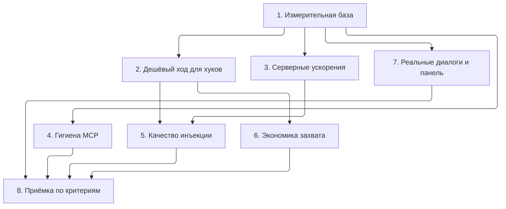

# План оптимизации интеграции с агентами (MCP и хуки)

Статус: **план**, ничего из этапов 1–7 ещё не реализовано. Основание — замеры и
разбор кода в `agent_hooks.py`, `mcp_server.py`, `retrieval_service.py`,
`chat_session_service.py` (см. раздел 0).

Цель: агент (Claude Code, Codex, Cursor, любой MCP-клиент) получает из памяти
только то, что помогает ответить, платит за это минимумом задержки и контекста, а
ArchitectOS захватывает факты, не удваивая работу. Критерии успеха — в §8.

---

## 0. Что измерено (исходная точка)

Синтетическая база, офлайн hash-эмбеддинги, Linux-контейнер; с облачным
эмбеддером к каждому ходу добавляется сетевой вызов (0,2–0,8 с, потолок 2,5 с).

| База | Холодный старт сервиса | `context()` на ход | Токенов в инъекции | `memory_turn` (вопрос / факт) | Хук без запущенного приложения |
| --- | --- | --- | --- | --- | --- |
| 500 | 18 мс | 120 мс | 595 | 113 / 107 мс | 146 мс |
| 2 000 | 37 мс | 169 мс | 705 | 162 / 224 мс | 341 мс |
| 15 000 | 223 мс | 1 008 мс | 949 | 1 093 / 1 832 мс | 1 815 мс |

Куда уходит время и контекст:

- `context()`: поиск (FTS + векторы) — 0,16 с из 1 с; остальное —
  `list_stable_memory` и `list_rule_layer_memory`, которые на каждом ходе
  вычитывают и разбирают JSON всех узлов типов Decision/Constraint/Requirement
  (105 тыс. `from_dict` на три вызова) и ранжируют в Python.
- Инъекция хука: 600–950 токенов на ход, из них ~60 % — стабильный слой,
  **одинаковый из хода в ход**. 50 ходов ≈ 30–45 тыс. токенов окна.
- Два события на ход (`UserPromptSubmit` + `Stop`), каждое — полный
  `capture_memory_turn` с поиском и захватом; при закрытом приложении каждое
  событие ещё и поднимает сервис с нуля.
- Хуки + MCP вместе: пакет инжектируется хуком, а инструкции MCP требуют от
  модели ещё и `memory_turn` на каждом сообщении — та же память дважды, плюс
  tool-round-trip (1–2 с, ~1 000 токенов).
- Каталог MCP: 19 инструментов ≈ **3 800 токенов** на каждую сессию
  (`memory_search` — 534, `memory_add` — 303, `memory_add_bulk` — 293,
  `memory_turn` — 253); стартовые инструкции ≈ 260 + briefing до 2 000 символов.
- LLM-экстрактор (при настроенном провайдере): до двух вызовов модели на ход.
- `graph_auto_linker.link_node` на каждой авто-записи читает все узлы
  (1,8 с на 15 тыс.).

### 0.1 Замер `scripts/bench_agent.py` (этап 1, 2026-11-03)

Один запуск `python3 scripts/bench_agent.py` (hash-эмбеддинги, 20 ходов на
сервисный и MCP-замер, 5 запусков каждого хука на транспорт). Машина: macOS 15.8.1,
Intel Core i9-9880H 2,3 ГГц, 16 потоков, 32 ГБ, Python 3.12.2. **Машина была
перегружена посторонними процессами** (load average 150–200 на 16 потоков), поэтому
абсолютные цифры в 2–5 раз хуже, чем в таблице выше, и шумные (500 узлов вышли
медленнее 2 000). Для сравнения этапов прогоны нужно повторять на свободной машине;
структура и соотношения ниже от нагрузки зависят слабо.

| База | Холодный старт сервиса | `context()` p50 / p95 | Токенов в инъекции | `memory_turn` p50 (вопрос / факт) | `memory_search` p50 | `UserPromptSubmit` HTTP | `UserPromptSubmit` офлайн | `SessionStart` офлайн | `Stop` офлайн |
| --- | --- | --- | --- | --- | --- | --- | --- | --- | --- |
| 500 | 222 мс | 1 187 / 1 363 мс | 1 003 | 908 / 1 390 мс | 402 мс | 1 992 (990) мс | 6 025 (4 753) мс | 5 465 (4 494) мс | 5 423 (4 647) мс |
| 2 000 | 226 мс | 797 / 974 мс | 1 003 | 554 / 856 мс | 165 мс | 1 339 (1 064) мс | 2 687 (2 305) мс | 1 983 (1 610) мс | 2 654 (2 258) мс |
| 15 000 | 2 544 мс | 2 366 / 4 940 мс | 1 003 | 2 437 / 5 038 мс | 1 262 мс | 3 651 (3 252) мс | 7 810 (7 157) мс | 3 644 (3 126) мс | 24 857 (23 831) мс |

Хуки — p50 времени подпроцесса `architectos_hook.py` целиком, в скобках — время
внутри процесса из строки `data/hooks.log` (без старта интерпретатора).

Что видно сверх таблицы §0:

- Пакет `context()` весит ~1 480 токенов при любом размере базы (бюджет 6 000
  символов заполнен); хук отрезает его до 4 000 символов, поэтому инъекция
  `UserPromptSubmit` всегда упирается в потолок 1 003 токена, `SessionStart` —
  ~500 токенов. Доля prompt-ходов с пустым пакетом на синтетике — 0.
- Разбивка `context()` на 15 тыс. (среднее): поиск 1 199 мс, стабильный и
  rule-слой 1 153 мс, остальное (задачи, провайдеры, упаковка, `token_economy` с
  проходом по всем узлам) 325 мс — подтверждает цель этапа 3.
- HTTP-транспорт на 15 тыс.: один из пяти `UserPromptSubmit` не уложился в
  HTTP-таймаут 5 с и ушёл в офлайн — событие стоило 17 с (p95), сервер при этом
  продолжал считать тот же ход. Таймауты этапа 2.5 это закрывают.
- Офлайн-событие платит импорт сервиса и его старт: ~1 с даже на пустой базе.
  `Stop` офлайн на 15 тыс. — 24 с: авто-запись факта плюс холодный старт
  (`link_node` из §0).
- Хук без работы (HTTP, `SessionStart` на 2 000) стоит ~0,3 с только на старт
  интерпретатора и импорт `agent_hooks`.

---

## 1. Этап 1 — Измерительная база (1–2 дня)

Без неё остальные этапы нельзя принять или отклонить.

1. **`scripts/bench_agent.py`** (есть черновик в scratchpad): латентность
   `SessionStart` / `UserPromptSubmit` / `Stop` / `memory_turn` / `memory_search`
   и токены инъекции на 500 / 2 000 / 15 000 узлов; вывод в JSON; запуск с
   hash-эмбеддингами и, по флагу, с настоящим провайдером.
2. **Тайминги в `data/hooks.log`** (`ARCHITECTOS_HOOK_DEBUG=1`): событие, транспорт
   (http / offline), мс, токены пакета, число новых попаданий. Сейчас лог пишет
   только ошибки.
3. **Счётчики в сервисе**: `capture_memory_turn` возвращает `timing`
   (search, stable, capture, extractor) и `pack_tokens`; keeper-событие
   `agent_turn` их сохраняет; `GET /api/memory/capture/stats` агрегирует за 7 дней
   (p50/p95 задержки, средние токены, доля ходов с пустым пакетом).
4. **Оценка каталога**: тест, который считает токены `TOOLS` и стартовых инструкций
   и падает при росте выше порога (§8).

Приёмка: один запуск скрипта даёт таблицу из §0; тест на размер каталога зелёный.

---

## 2. Этап 2 — Дешёвый ход для хуков (2–3 дня, самый большой эффект)

Цель: один ход агента стоит ≤ 300 мс и ≤ 400 токенов на базе до 15 тыс. узлов.

1. **Стабильный слой один раз на сессию.** `HookTurn.session_id` уже
   разбирается (`_SESSION_FIELDS`). Хук ведёт `data/hook_sessions/<session_id>.json`:
   какие id уже инжектированы и когда. `SessionStart` отдаёт briefing (как сейчас);
   `UserPromptSubmit` отдаёт только попадания под вопрос, которых в сессии ещё не
   было; стабильный слой повторяется лишь если его не было ≥ N ходов назад (после
   компакции у клиента) — порог настраиваемый. Cursor без `SessionStart`: первый
   `beforeSubmitPrompt` сессии играет роль старта.
   Эффект: −60 % токенов на ход, −`list_stable_memory`/`list_rule_layer_memory`
   на каждом ходе (−0,8 с на 15 тыс.).
2. **Бюджет инъекции для хуков**: `char_budget` 1 600 (≈ 400 токенов) и
   `node_text_chars` 220 вместо общих 6 000 / 700; настройка
   `agent.hook_char_budget`. Пакет без попаданий выше порога релевантности не
   инжектируется вовсе (сейчас фильтр — «есть хоть что-то»).
3. **Захват только на `Stop`.** `UserPromptSubmit` сохраняет текст вопроса в файл
   сессии и инжектирует; `Stop` берёт пару «вопрос + ответ» и делает один
   `capture_memory_turn(user, assistant)`. Вдвое меньше захватов и вызовов
   LLM-экстрактора, факты точнее (виден и вопрос, и ответ). Cursor: то же через
   `beforeSubmitPrompt` → `afterAgentResponse`.
4. **Без холодных стартов.** Офлайн-режим хука (приложение закрыто) не поднимает
   `ArchitectOSService`:
   - инъекция — из `data/briefing_cache.json`, который приложение обновляет при
     изменении стабильного слоя (SessionStart) и из последнего пакета по проекту;
   - захват — в спул `data/hook_spool.jsonl`; приложение при старте и раз в
     минуту (`chat-session-idle` loop) прогоняет спул через `capture_memory_turn`.
   Эффект: 0 мс сервисного старта на событие; при открытом приложении — HTTP, как
   сейчас. `ARCHITECTOS_HOOK_OFFLINE=0` оставить как «молчать совсем».
5. **Таймауты**: HTTP-таймаут хука 5 с → 2 с для инъекции (пакет либо готов
   быстро, либо не нужен), 5 с для захвата; таймаут векторного поиска в режиме
   хука 800 мс (`vector_query_timeout_ms` переопределяется параметром запроса).

Приёмка: bench на 15 тыс. узлов — `UserPromptSubmit` p95 ≤ 300 мс по HTTP,
средняя инъекция ≤ 400 токенов, повторная инъекция одного id в сессии = 0;
офлайн-событие ≤ 20 мс.

---

## 3. Этап 3 — Серверные ускорения (2–3 дня)

1. **Кеш стабильного и rule-слоя** на проект: список разобранных узлов, инвалидация
   из `upsert_node` (как FTS и dedup-индекс). Ранжирование под вопрос — по
   кешу. `context()` на 15 тыс.: ~1 с → ~0,2 с. Нужен и для Ask, не только для хуков.
2. **Проекция вместо полного payload** в `list_nodes(node_types=…)`: SQL отдаёт
   `id, type, label, text(≤700), metadata(кусок)`, без `json.loads` всего узла;
   либо колонки `label/text` уже есть — проверить и использовать.
3. **Индекс для `link_node`**: инвертированный индекс токенов линкера (аналог
   `memory_dedup_stems`) или переиспользование основ; авто-запись факта
   1,8 с → ≤ 0,2 с на 15 тыс. (задача уже описана ранее).
4. **Одно вложение запроса на ход**: `UserPromptSubmit` и `Stop` одного хода
   считают эмбеддинг одного текста дважды; кеш `_embed_query_cached` уже есть
   (TTL 300 с) — убедиться, что захват на `Stop` использует тот же ключ.
5. **Параллельность внутри `context()`**: FTS, векторы и стабильный слой уже
   частично параллельны; после кеша из п. 1 проверить, что остаток укладывается в
   один проход по SQLite.

Приёмка: `context()` p95 ≤ 250 мс на 15 тыс. узлов с hash-эмбеддингами;
`capture_memory_turn` с авто-записью ≤ 400 мс.

---

## 4. Этап 4 — Гигиена MCP-протокола (1–2 дня)

1. **Каталог инструментов** ≈ 3 800 → ≤ 1 500 токенов: описания до 1–2
   предложений, детали — в `docs/MCP_MEMORY_SERVER.md`; `inputSchema` без
   повторяющихся пояснений про привязку проекта (одна фраза в инструкциях);
   редкие инструменты (`memory_themes`, `memory_history`, `source_*`,
   `memory_add_bulk`, `memory_compact`) — за флагом `--tools full` или
   отдельным MCP-профилем «advanced».
2. **Не требовать `memory_turn` при установленных хуках.** Сервер проверяет,
   установлены ли хуки для клиента (`hook doctor` это уже умеет) или получает
   `--hooks-installed`; тогда инструкции: «память уже инжектируется, вызывай
   `memory_search` только для уточнения, `memory_add` для явных фактов».
3. **Разделить чтение и запись**: `memory_turn` получает `capture: false`
   (только пакет), а инструкции советуют захват один раз в конце задачи
   (`memory_turn` с `assistant_text`), а не на каждом сообщении — тот же принцип,
   что `Stop` у хуков.
4. **Briefing в инструкциях ≤ 1 200 символов** и только при привязанном проекте;
   строка о превышении бюджета индекса остаётся.
5. **Ответы инструментов короче**: `memory_turn` и `memory_search` возвращают
   `hits` без `metadata` целиком (есть `_compact_hit`, проверить, что применяется
   везде) и без дублирования `context` + `hits`, когда клиент читает только текст.

Приёмка: токены каталога и инструкций по тесту из этапа 1; сценарий «хуки +
MCP» в тестах не вызывает `memory_turn` на каждом сообщении.

---

## 5. Этап 5 — Качество того, что инжектируется (2–3 дня)

Задержка — половина цены; вторая половина — шум в контексте.

1. **Порог релевантности для инъекции** отдельно от поиска в UI: попадание
   попадает в пакет только при `score ≥ search_relevance_floor + δ`; при пустом
   результате хук молчит (сейчас шлёт пакет с заголовком и стабильным слоем).
2. **Свежесть и статус в строке памяти**: `invalid_at`-узлы не инжектируются
   (сейчас фильтр есть только в dedup); у устаревших значений — пометка
   `superseded`; конфликтующие пары (`CONTRADICTS`) подаются вместе с пометкой
   «есть противоречие», а не как две независимые истины.
3. **Один раз за сессию** — из этапа 2; плюс «не повторять попадания, которые
   агент уже видел в последних K ходах».
4. **Обратная связь без участия человека**: если ответ ассистента (на `Stop`)
   цитирует `id=…` из пакета или дословно использует факт — `memory_feedback`
   «использовано» автоматически; не использованные N раз подряд попадания
   понижаются в ранге (`feedback_scores_for_nodes` уже участвует в ранжировании).
5. **Сжатие строки**: `label: text` до 160 символов, без evidence-путей и
   `score=` в пакете для агента (они нужны UI, не модели).

Приёмка: на наборе из 30 реальных вопросов (этап 7) средняя инъекция ≤ 350
токенов при той же или лучшей доле «нужный факт попал в пакет».

---

## 6. Этап 6 — Экономика захвата (1–2 дня)

1. **LLM-экстрактор только на `Stop` / в конце сессии** (следствие этапа 2).
2. **Бюджет вызовов**: `memory_capture.llm_max_calls_per_hour` (например 30);
   при исчерпании — эвристика, событие в счётчиках.
3. **Батч для хуков**: если ходы идут чаще, чем раз в N секунд (агент в цикле
   инструментов), захватывать не каждый ход, а накопленную пару «последний
   вопрос пользователя + финальный ответ».
4. **Экстрактор `auto` не включается для платных провайдеров без явного
   согласия**: `auto` = локальная модель (Ollama/local) или явно выбранный
   `llm_provider_id`; для облачных — подсказка в настройках и переключение вручную.
5. **Дедуп до вызова модели**: если эвристика нашла только факты, которые шлюз
   уже считает дублями (`dedup preview`), модель не вызывается.

Приёмка: число вызовов модели за сессию из 50 ходов ≤ 25 при `extractor: llm`,
0 при `heuristic`; счётчики видны на странице настроек.

---

## 7. Этап 7 — Проверка на реальных диалогах и наблюдаемость (параллельно с 2–6)

1. **Набор из реальных сессий**: 30–50 вопросов из твоих диалогов (Ask, Claude
   Code) с разметкой «какой факт должен был попасть в контекст»; хранится в
   `tests/data/agent_gold.jsonl` (без секретов).
2. **A/B-прогон**: ответы агента без памяти / с текущим пакетом / с пакетом после
   этапов 2 и 5; метрики — доля нужных фактов в пакете, токены, задержка;
   субъективная оценка ответов по 3–5 вопросам.
3. **Панель «Агенты»** в UI: последние ходы с транспортом, задержкой, токенами,
   числом попаданий и захваченных фактов; предупреждение, если p95 > порога.
4. **`architectos hook doctor`** показывает тайминги последних событий и советует
   режим (HTTP / спул), если приложение чаще закрыто, чем открыто.

---

## 8. Критерии приёмки всего плана

| Показатель | Сейчас (15 тыс. узлов) | Цель |
| --- | --- | --- |
| `UserPromptSubmit` по HTTP, p95 | ≈ 1 100 мс | ≤ 300 мс |
| Событие хука при закрытом приложении | ≈ 1 800 мс | ≤ 20 мс |
| Токенов инъекции на ход, среднее | 600–950 | ≤ 400 (после 1-го хода ≤ 250) |
| Повторная инъекция одного факта в сессии | каждый ход | 0 |
| Каталог MCP + инструкции | ≈ 4 100 токенов | ≤ 2 000 |
| Вызовов LLM-экстрактора на ход | до 2 | ≤ 0,5 |
| Авто-запись факта (`link_node`) | ≈ 1 800 мс | ≤ 400 мс |
| Хуки + MCP: двойная инъекция | есть | нет |

## 9. Порядок и зависимости

Этапы 2, 3, 4 независимы и могут идти параллельно; 5 и 6 опираются на 2.
Оценка общего объёма: 10–15 рабочих дней, из них этапы 2 + 3 дают ~80 % эффекта.

## 10. Риски

- **Состояние сессии в хуках** (этап 2.1): если клиент не передаёт `session_id`
  (часть версий Cursor), откат на поведение «как сейчас» для этого клиента.
- **Спул захвата** (2.4): факты попадают в память с задержкой до минуты, пока
  приложение закрыто — дольше; это честнее, чем молчаливый холодный старт на
  каждое событие, но нужно показать в `doctor`.
- **Сокращение описаний инструментов** (4.1) может ухудшить выбор инструмента
  слабыми моделями — проверять на Codex/Cursor сценариях из этапа 7.
- **Авто-обратная связь** (5.4) по цитированию `id=` зависит от того, цитирует
  ли модель id; без этого остаётся ручной `memory_feedback`.
