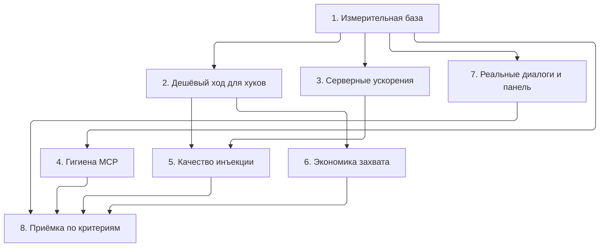

# План оптимизации интеграции с агентами (MCP и хуки)

Статус: этап 1 влит в `main`, этап 2 — в ветке, этапы 3–7 не начаты (см. «Статус
этапов»). Основание — замеры и разбор кода в `agent_hooks.py`, `mcp_server.py`,
`retrieval_service.py`, `chat_session_service.py` (см. раздел 0).

## Статус этапов

| Этап | Состояние |
| --- | --- |
| 1. Измерительная база | влит в `main` (`eadb85f`) |
| 2. Дешёвый ход для хуков | влит в `main` (`3c99421`) с невыполненным критерием HTTP p95: по §0.2 токены, повторы и офлайн выполнены, `UserPromptSubmit` по HTTP p95 ≤ 300 мс на 100 запусках — нет (527 мс). Выбор архитектуры (варианты A/B/C, §0.2) за пользователем. Доработки после ревью — в той же ветке |
| 3. Серверные ускорения | не начат (часть поиска для режима хука сделана в этапе 2, §0.2) |
| 4. Гигиена MCP-протокола | не начат |
| 5. Качество инъекции | не начат |
| 6. Экономика захвата | не начат |
| 7. Реальные диалоги и наблюдаемость | не начат |

Решение пользователя по критерию этапа 2 «`UserPromptSubmit` по HTTP p95 ≤ 300 мс на
15 тыс. узлов»: дожимать в рамках этапа 2, а не переносить на этап 3. Поэтому в ветку
этапа 2 вошли ускорения серверного пути режима хука и облегчение процесса хука (§0.2).

Цель: агент (Claude Code, Codex, Cursor, любой MCP-клиент) получает из памяти
только то, что помогает ответить, платит за это минимумом задержки и контекста, а
ArchitectOS захватывает факты, не удваивая работу. Критерии успеха — в §8.

---

## 0. Что измерено (исходная точка)

Синтетическая база, офлайн hash-эмбеддинги, Linux-контейнер; с облачным
эмбеддером к каждому ходу добавляется сетевой вызов (0,2–0,8 с, потолок 2,5 с).

| База | Холодный старт сервиса | `context()` на ход | Токенов в инъекции | `memory_turn` (вопрос / факт) | Хук без запущенного приложения |
| --- | --- | --- | --- | --- | --- |
| 500 | 18 мс | 120 мс | 595 | 113 / 107 мс | 146 мс |
| 2 000 | 37 мс | 169 мс | 705 | 162 / 224 мс | 341 мс |
| 15 000 | 223 мс | 1 008 мс | 949 | 1 093 / 1 832 мс | 1 815 мс |

Куда уходит время и контекст:

- `context()`: поиск (FTS + векторы) — 0,16 с из 1 с; остальное —
  `list_stable_memory` и `list_rule_layer_memory`, которые на каждом ходе
  вычитывают и разбирают JSON всех узлов типов Decision/Constraint/Requirement
  (105 тыс. `from_dict` на три вызова) и ранжируют в Python.
- Инъекция хука: 600–950 токенов на ход, из них ~60 % — стабильный слой,
  **одинаковый из хода в ход**. 50 ходов ≈ 30–45 тыс. токенов окна.
- Два события на ход (`UserPromptSubmit` + `Stop`), каждое — полный
  `capture_memory_turn` с поиском и захватом; при закрытом приложении каждое
  событие ещё и поднимает сервис с нуля.
- Хуки + MCP вместе: пакет инжектируется хуком, а инструкции MCP требуют от
  модели ещё и `memory_turn` на каждом сообщении — та же память дважды, плюс
  tool-round-trip (1–2 с, ~1 000 токенов).
- Каталог MCP: 19 инструментов ≈ **3 800 токенов** на каждую сессию
  (`memory_search` — 534, `memory_add` — 303, `memory_add_bulk` — 293,
  `memory_turn` — 253); стартовые инструкции ≈ 260 + briefing до 2 000 символов.
- LLM-экстрактор (при настроенном провайдере): до двух вызовов модели на ход.
- `graph_auto_linker.link_node` на каждой авто-записи читает все узлы
  (1,8 с на 15 тыс.).

### 0.1 Замер `scripts/bench_agent.py` (этап 1, 2026-11-03)

Один запуск `python3 scripts/bench_agent.py` (hash-эмбеддинги, 20 ходов на
сервисный и MCP-замер, 5 запусков каждого хука на транспорт). Машина: macOS 15.8.1,
Intel Core i9-9880H 2,3 ГГц, 16 потоков, 32 ГБ, Python 3.12.2. **Машина была
перегружена посторонними процессами** (load average 150–200 на 16 потоков), поэтому
абсолютные цифры в 2–5 раз хуже, чем в таблице выше, и шумные (500 узлов вышли
медленнее 2 000). Для сравнения этапов прогоны нужно повторять на свободной машине;
структура и соотношения ниже от нагрузки зависят слабо.

| База | Холодный старт сервиса | `context()` p50 / p95 | Токенов в инъекции | `memory_turn` p50 (вопрос / факт) | `memory_search` p50 | `UserPromptSubmit` HTTP | `UserPromptSubmit` офлайн | `SessionStart` офлайн | `Stop` офлайн |
| --- | --- | --- | --- | --- | --- | --- | --- | --- | --- |
| 500 | 222 мс | 1 187 / 1 363 мс | 1 003 | 908 / 1 390 мс | 402 мс | 1 992 (990) мс | 6 025 (4 753) мс | 5 465 (4 494) мс | 5 423 (4 647) мс |
| 2 000 | 226 мс | 797 / 974 мс | 1 003 | 554 / 856 мс | 165 мс | 1 339 (1 064) мс | 2 687 (2 305) мс | 1 983 (1 610) мс | 2 654 (2 258) мс |
| 15 000 | 2 544 мс | 2 366 / 4 940 мс | 1 003 | 2 437 / 5 038 мс | 1 262 мс | 3 651 (3 252) мс | 7 810 (7 157) мс | 3 644 (3 126) мс | 24 857 (23 831) мс |

Хуки — p50 времени подпроцесса `architectos_hook.py` целиком, в скобках — время
внутри процесса из строки `data/hooks.log` (без старта интерпретатора).

Что видно сверх таблицы §0:

- Пакет `context()` весит ~1 480 токенов при любом размере базы (бюджет 6 000
  символов заполнен); хук отрезает его до 4 000 символов, поэтому инъекция
  `UserPromptSubmit` всегда упирается в потолок 1 003 токена, `SessionStart` —
  ~500 токенов. Доля prompt-ходов с пустым пакетом на синтетике — 0.
- Разбивка `context()` на 15 тыс. (среднее): поиск 1 199 мс, стабильный и
  rule-слой 1 153 мс, остальное (задачи, провайдеры, упаковка, `token_economy` с
  проходом по всем узлам) 325 мс — подтверждает цель этапа 3.
- HTTP-транспорт на 15 тыс.: один из пяти `UserPromptSubmit` не уложился в
  HTTP-таймаут 5 с и ушёл в офлайн — событие стоило 17 с (p95), сервер при этом
  продолжал считать тот же ход. Таймауты этапа 2.5 это закрывают.
- Офлайн-событие платит импорт сервиса и его старт: ~1 с даже на пустой базе.
  `Stop` офлайн на 15 тыс. — 24 с: авто-запись факта плюс холодный старт
  (`link_node` из §0).
- Хук без работы (HTTP, `SessionStart` на 2 000) стоит ~0,3 с только на старт
  интерпретатора и импорт `agent_hooks`.

### 0.2 Замер после этапа 2 (итог, 2026-11-17)

`python3 scripts/bench_agent.py --sizes 15000 --hook-runs 100` подряд на `main` (`caac381`,
`origin/main` после слияния гейта дедупликации, с `bench_agent.py` из ветки) и на ветке этапа 2
(`18d67a6`). Машина и Python те же, что в §0.1, hash-эмбеддинги, 20 ходов на сервисный и
MCP-замер, 100 запусков каждого хука на транспорт. Каждый прогон начинался после того, как
1-минутный load average три проверки подряд был < 12, а 5-минутный < 20; load снимался
поминутно. Перед замером каждое событие хука запускается один раз без учёта: так байткод
уже лежит в кэше, как у агента после первого хода дня (`PYTHONDONTWRITEBYTECODE` bench
снимает). Запуски не отбрасывались; p95 и p99 — nearest-rank по всем 100.

| База 15 000, 100 запусков | `main` `caac381` | этап 2 `18d67a6` |
| --- | --- | --- |
| Load average 1 / 5 мин за прогон (мин–макс) | 3,9–44,7 / 6,6–21,9¹ | 4,9–9,7 / 5,8–7,2 |
| `UserPromptSubmit` HTTP, wall p50 / p95 / p99 / max | 3 781 / 15 792 / 17 836 / 23 366 мс | 346 / 527 / 1 035 / 1 533 мс |
| то же, внутри процесса хука p50 / p95 / p99 / max | 3 537 / 15 298 / 17 299 / 22 654 мс | 193 / 312 / 880 / 1 376 мс |
| Инъекция `UserPromptSubmit` по HTTP, токенов (среднее) | 1 003 | 382 |
| Повторы id в HTTP-сессии (из них в хитах) | 358 (0) | 4 (0)² |
| Офлайн внутри процесса, худшее событие p50 / p95 / p99 / max | 4 775 / 8 130 / 8 798 / 11 206 мс (prompt) | 3,7 / 8,5 / 26 / 75 мс (`SessionStart`) |
| Офлайн wall p50 (`SessionStart` / prompt / `Stop`) | 1 407 / 5 106 / 4 100 мс | 110 / 102 / 102 мс |
| `SessionStart` HTTP wall p50 / p95 | 1 088 / 1 438 мс | 771 / 805 мс |
| `Stop` HTTP wall p50 / p95 | 2 546 / 3 120 мс | 251 / 341 мс |
| `context()` p50 / p95 (20 ходов, не хук) | 3 124 / 3 511 мс | 1 022 / 1 222 мс |
| `memory_turn` p50 вопрос / факт; `memory_search` p50 | 2 819 / 5 100; 632 мс | 1 019 / 2 239; 82 мс |
| Холодный старт сервиса | 961 мс | 540 мс |

¹ Во время `main` были посторонние пики: 44,7 / 21,9 на 16-й минуте, 16–21 ещё трижды.
Цифры `main` этим завышены, но разрыв с веткой на порядок, и вывод от нагрузки не зависит.
² Повтор стабильного слоя раз в `agent.hook_stable_every_turns` (20) ходов, так задумано
(§2.1): на 100 ходах он сработал 4 раза. Среди попаданий под вопрос повторов нет. На 20
ходах, как в прежних прогонах, повторов 0.

| Критерий этапа 2 (15 000, 100 запусков) | Цель | `main` | этап 2 | Итог |
| --- | --- | --- | --- | --- |
| `UserPromptSubmit` HTTP, wall p95 | ≤ 300 мс | 15 792 мс | 527 мс | **не выполнен** |
| Инъекция `UserPromptSubmit`, токенов (среднее) | ≤ 400 | 1 003 | 382 | выполнен |
| Повторная инъекция id в сессии | 0 | 358 | 0 среди попаданий, 4 — плановый повтор стабильного слоя | выполнен с оговоркой ² |
| Офлайн-событие внутри процесса (худшее событие) | ≤ 20 мс | 4 775 / 8 130 мс | p50 3,7, p95 8,5 мс (p99 26 мс) | выполнен по p50/p95 |

Ещё три прогона ветки по 100 запусков на `aada465` (код хука тот же, что `18d67a6`, меняется
только `bench_agent.py`) показывают разброс HTTP p95:

| Прогон ветки, 100 запусков | Load 1 / 5 мин | HTTP wall p50 / p95 / p99 / max | внутри процесса p50 / p95 |
| --- | --- | --- | --- |
| корпус в системном temp (по умолчанию) | 5,1–8,7 / 5,1–5,9 | 280 / 487 / 748 / 751 мс | 154 / 293 мс |
| корпус в `/private/tmp` (`--work-dir`) | 4,1–7,4 / 5,1–5,7 | 243 / 556 / 762 / 766 мс | 135 / 299 мс |
| корпус в системном temp, следом | 6,9–47,0 / 7,0–23,6 | 352 / 703 / 959 / 1 478 мс | 187 / 352 мс — под нагрузкой, не для приёмки |

На 40–60 запусках на почти свободной машине тот же хук укладывается: на копии корпуса 15 тыс.
wall 220 / 227 / 240 мс (p50 / p95 / max, 60 запусков, load 4,3–4,9), на свежем корпусе 202 / 213
/ 219 мс (40 запусков). Хвост p95–p99 на 100 запусках даёт сервер: время внутри процесса хука
p95 293–312 мс при p50 135–193 мс. Сборка мусора его не объясняет: за все события прогона
пауза gen2 не длиннее 37 мс. Фоновые потоки приложения тоже нет — bench их не запускает. Хвост
растёт с load машины, а машина делилась с параллельными сессиями. Точную причину отдельных
медленных ответов (300–650 мс) этот замер не установил.

Из чего складывается ход `UserPromptSubmit` по HTTP (свободная машина, load 4,3–4,9, копия
корпуса 15 тыс., 60 запусков, p50):

| Часть | Время | Что внутри |
| --- | --- | --- |
| старт интерпретатора | 47 мс | `python -c pass` (`-I -S` — 43 мс): `encodings`, `site`, `.pth` venv |
| импорт хука | ~50 мс | `import architectos.agent_hooks` 96 мс минус старт. По `-X importtime` (24 мс исполнения модулей): `pathlib` 17 (из них `re` 9, `urllib.parse` 5), `socket` 6, `hashlib` 5, `typing` 4, `json` 3, сам модуль 3,5 |
| запуск, разбор stdin, выход процесса | ~17 мс | разница wall − (старт + импорт + работа внутри процесса) |
| работа хука вне сервера | 4 мс | файл сессии, JSON, сокет |
| сервер `capture_memory_turn` | ~100 мс | профиль ниже: FTS 51, векторы 21, выборка узлов 3, лайфцикл 3, пакет и кэш 2 |
| **итого wall** | **220 мс** (p95 227) | фиксированная часть процесса ~114 мс |

Серверный путь режима хука до и после этапа (профиль `capture_memory_turn(hook=True,
capture=False)`, 40 ходов, корпус 15 тыс., p50 / p95):

| Шаг | до (`c0eb790`, load 5–14) | после (`527ffad`, load 4) | что сделано |
| --- | --- | --- | --- |
| весь ход | 879 / 1 122 мс | 79 / 91 мс | — |
| `lifecycle.refresh_nodes` | 413 / 564 мс | 3,3 / 4,5 мс | одно `UPDATE` метаданных на все попадания в одной транзакции, без пересборки FTS и дедупа |
| векторный поиск | 418 / 555 мс | 21 / 23 мс | `math.sumprod`, кэш видимых строк по проекту и scope, скалярное произведение только по ненулевым измерениям запроса |
| FTS | 145 / 222 мс | 51 / 59 мс | `ORDER BY rank` вместо `bm25()` (порядок совпал в 160 из 160 запросов) |
| `get_setting` | 116 / 169 мс | 0,1 / 2,8 мс | кэш на 1 с в процессе, сброс при записи |
| расширение графа | входило в поиск | нет | пакет хука без PageRank-расширения |
| HTTP-запрос целиком | 748 / 1 297 мс | 80 / 98 мс | — |

Процесс хука при закрытом приложении стоил 219 мс (до), 105 мс (после): лёгкий транспорт на
сокете вместо `urllib`, `HookTurn` на `NamedTuple`, только парсер `capture` (а для строки,
которую регистрирует установщик, без `argparse` вообще), `logging` и SDK не грузятся на пути
хука, байткод кэшируется.

Качество (`scripts/bench_gold_queries.json`, 18 запросов, реальный проект ~11 тыс. узлов): с
расширением графа и без него hit@1 0,778, hit@инъекции 0,889, MRR 0,824 — одинаково;
состав инъекции совпадает в среднем на 75 % (Jaccard), `hook_context` p50 553 → 265 мс.
Другие вызывающие (`memory_turn`/`memory_context` в MCP, UI, `context()`) граф расширяют как раньше.

Офлайн-выбросы 26 мс из прогона 2026-11-06 — нагрузка машины: на свободной машине 120 запусков
подпроцессом и 400 в процессе дали p95 ~5 мс, максимум 5,7 мс.

Предварительные прогоны (на 20 запусках или под нагрузкой; для приёмки не используются):
2026-11-06 на `4cc4878` (load 5–36): HTTP p95 1 066 мс; 2026-11-17 на `527ffad`, 20 запусков
(load 4–6): p50 285, p95 346 мс; проверочные прогоны только ветки после `f429452`: p95 297–302 мс.

Что ещё можно снять, не меняя архитектуру, и сколько:

- импорт хука: `os.path` вместо `pathlib` в пути хука и строковый разбор вместо `re` (−10…17 мс),
  `hashlib` → имя файла сессии без SHA-256 или `_sha2` (−4…5 мс), `typing` без `NamedTuple`
  (−4 мс), запуск с `-S` (−4 мс) — вместе ~20–30 мс;
- сервер: FTS 51 мс — синтетика из 40 слов, каждое слово встречается в тысячах узлов; сужение
  кандидатов FTS до ранжирования — задача этапа 3 с проверкой качества.

Даже вместе это ~50–80 мс к p50, а p95 на 100 запусках упирается в хвост сервера под нагрузкой.
Порог 300 мс на p95 по 100 запускам на этой машине без архитектурного решения не гарантирован.
Варианты (решение за пользователем): хук без интерпретатора Python (тонкий HTTP-клиент,
состояние сессии на сервере) — минус ~110 мс фиксированной части; поиск хука в отдельном
процессе или нативный векторный индекс (этап 3); или критерий по времени внутри процесса /
на свободной машине.

Настройки и переменные окружения этапа 2 (`agent.hook_char_budget`,
`agent.hook_stable_every_turns`, `agent.hook_min_score`, `ARCHITECTOS_HOOK_INJECT_TIMEOUT`,
`ARCHITECTOS_HOOK_TIMEOUT`, `ARCHITECTOS_HOOK_OFFLINE`) описаны в `docs/AGENT_HOOKS.md`.

---

## 1. Этап 1 — Измерительная база (1–2 дня)

Без неё остальные этапы нельзя принять или отклонить.

1. **`scripts/bench_agent.py`** (есть черновик в scratchpad): латентность
   `SessionStart` / `UserPromptSubmit` / `Stop` / `memory_turn` / `memory_search`
   и токены инъекции на 500 / 2 000 / 15 000 узлов; вывод в JSON; запуск с
   hash-эмбеддингами и, по флагу, с настоящим провайдером.
2. **Тайминги в `data/hooks.log`** (`ARCHITECTOS_HOOK_DEBUG=1`): событие, транспорт
   (http / offline), мс, токены пакета, число новых попаданий. Сейчас лог пишет
   только ошибки.
3. **Счётчики в сервисе**: `capture_memory_turn` возвращает `timing`
   (search, stable, capture, extractor) и `pack_tokens`; keeper-событие
   `agent_turn` их сохраняет; `GET /api/memory/capture/stats` агрегирует за 7 дней
   (p50/p95 задержки, средние токены, доля ходов с пустым пакетом).
4. **Оценка каталога**: тест, который считает токены `TOOLS` и стартовых инструкций
   и падает при росте выше порога (§8).

Приёмка: один запуск скрипта даёт таблицу из §0; тест на размер каталога зелёный.

---

## 2. Этап 2 — Дешёвый ход для хуков (2–3 дня, самый большой эффект)

Цель: один ход агента стоит ≤ 300 мс и ≤ 400 токенов на базе до 15 тыс. узлов.

1. **Стабильный слой один раз на сессию.** `HookTurn.session_id` уже
   разбирается (`_SESSION_FIELDS`). Хук ведёт `data/hook_sessions/<session_id>.json`:
   какие id уже инжектированы и когда. `SessionStart` отдаёт briefing (как сейчас);
   `UserPromptSubmit` отдаёт только попадания под вопрос, которых в сессии ещё не
   было; стабильный слой повторяется лишь если его не было ≥ N ходов назад (после
   компакции у клиента) — порог настраиваемый. Cursor без `SessionStart`: первый
   `beforeSubmitPrompt` сессии играет роль старта.
   Эффект: −60 % токенов на ход, −`list_stable_memory`/`list_rule_layer_memory`
   на каждом ходе (−0,8 с на 15 тыс.).
2. **Бюджет инъекции для хуков**: `char_budget` 1 600 (≈ 400 токенов) и
   `node_text_chars` 220 вместо общих 6 000 / 700; настройка
   `agent.hook_char_budget`. Пакет без попаданий выше порога релевантности не
   инжектируется вовсе (сейчас фильтр — «есть хоть что-то»).
3. **Захват только на `Stop`.** `UserPromptSubmit` сохраняет текст вопроса в файл
   сессии и инжектирует; `Stop` берёт пару «вопрос + ответ» и делает один
   `capture_memory_turn(user, assistant)`. Вдвое меньше захватов и вызовов
   LLM-экстрактора, факты точнее (виден и вопрос, и ответ). Cursor: то же через
   `beforeSubmitPrompt` → `afterAgentResponse`.
4. **Без холодных стартов.** Офлайн-режим хука (приложение закрыто) не поднимает
   `ArchitectOSService`:
   - инъекция — из `data/briefing_cache.json`, который приложение обновляет при
     изменении стабильного слоя (SessionStart) и из последнего пакета по проекту;
   - захват — в спул `data/hook_spool.jsonl`; приложение при старте и раз в
     минуту (`chat-session-idle` loop) прогоняет спул через `capture_memory_turn`.
   Эффект: 0 мс сервисного старта на событие; при открытом приложении — HTTP, как
   сейчас. `ARCHITECTOS_HOOK_OFFLINE=0` оставить как «молчать совсем».
5. **Таймауты**: HTTP-таймаут хука 5 с → 2 с для инъекции (пакет либо готов
   быстро, либо не нужен), 5 с для захвата; таймаут векторного поиска в режиме
   хука 800 мс (`vector_query_timeout_ms` переопределяется параметром запроса).

Приёмка: bench на 15 тыс. узлов — `UserPromptSubmit` p95 ≤ 300 мс по HTTP,
средняя инъекция ≤ 400 токенов, повторная инъекция одного id в сессии = 0;
офлайн-событие ≤ 20 мс.

---

## 3. Этап 3 — Серверные ускорения (2–3 дня)

1. **Кеш стабильного и rule-слоя** на проект: список разобранных узлов, инвалидация
   из `upsert_node` (как FTS и dedup-индекс). Ранжирование под вопрос — по
   кешу. `context()` на 15 тыс.: ~1 с → ~0,2 с. Нужен и для Ask, не только для хуков.
2. **Проекция вместо полного payload** в `list_nodes(node_types=…)`: SQL отдаёт
   `id, type, label, text(≤700), metadata(кусок)`, без `json.loads` всего узла;
   либо колонки `label/text` уже есть — проверить и использовать.
3. **Индекс для `link_node`**: инвертированный индекс токенов линкера (аналог
   `memory_dedup_stems`) или переиспользование основ; авто-запись факта
   1,8 с → ≤ 0,2 с на 15 тыс. (задача уже описана ранее).
4. **Одно вложение запроса на ход**: `UserPromptSubmit` и `Stop` одного хода
   считают эмбеддинг одного текста дважды; кеш `_embed_query_cached` уже есть
   (TTL 300 с) — убедиться, что захват на `Stop` использует тот же ключ.
5. **Параллельность внутри `context()`**: FTS, векторы и стабильный слой уже
   частично параллельны; после кеша из п. 1 проверить, что остаток укладывается в
   один проход по SQLite.

Приёмка: `context()` p95 ≤ 250 мс на 15 тыс. узлов с hash-эмбеддингами;
`capture_memory_turn` с авто-записью ≤ 400 мс.

---

## 4. Этап 4 — Гигиена MCP-протокола (1–2 дня)

1. **Каталог инструментов** ≈ 3 800 → ≤ 1 500 токенов: описания до 1–2
   предложений, детали — в `docs/MCP_MEMORY_SERVER.md`; `inputSchema` без
   повторяющихся пояснений про привязку проекта (одна фраза в инструкциях);
   редкие инструменты (`memory_themes`, `memory_history`, `source_*`,
   `memory_add_bulk`, `memory_compact`) — за флагом `--tools full` или
   отдельным MCP-профилем «advanced».
2. **Не требовать `memory_turn` при установленных хуках.** Сервер проверяет,
   установлены ли хуки для клиента (`hook doctor` это уже умеет) или получает
   `--hooks-installed`; тогда инструкции: «память уже инжектируется, вызывай
   `memory_search` только для уточнения, `memory_add` для явных фактов».
3. **Разделить чтение и запись**: `memory_turn` получает `capture: false`
   (только пакет), а инструкции советуют захват один раз в конце задачи
   (`memory_turn` с `assistant_text`), а не на каждом сообщении — тот же принцип,
   что `Stop` у хуков.
4. **Briefing в инструкциях ≤ 1 200 символов** и только при привязанном проекте;
   строка о превышении бюджета индекса остаётся.
5. **Ответы инструментов короче**: `memory_turn` и `memory_search` возвращают
   `hits` без `metadata` целиком (есть `_compact_hit`, проверить, что применяется
   везде) и без дублирования `context` + `hits`, когда клиент читает только текст.

Приёмка: токены каталога и инструкций по тесту из этапа 1; сценарий «хуки +
MCP» в тестах не вызывает `memory_turn` на каждом сообщении.

---

## 5. Этап 5 — Качество того, что инжектируется (2–3 дня)

Задержка — половина цены; вторая половина — шум в контексте.

1. **Порог релевантности для инъекции** отдельно от поиска в UI: попадание
   попадает в пакет только при `score ≥ search_relevance_floor + δ`; при пустом
   результате хук молчит (сейчас шлёт пакет с заголовком и стабильным слоем).
2. **Свежесть и статус в строке памяти**: `invalid_at`-узлы не инжектируются
   (сейчас фильтр есть только в dedup); у устаревших значений — пометка
   `superseded`; конфликтующие пары (`CONTRADICTS`) подаются вместе с пометкой
   «есть противоречие», а не как две независимые истины.
3. **Один раз за сессию** — из этапа 2; плюс «не повторять попадания, которые
   агент уже видел в последних K ходах».
4. **Обратная связь без участия человека**: если ответ ассистента (на `Stop`)
   цитирует `id=…` из пакета или дословно использует факт — `memory_feedback`
   «использовано» автоматически; не использованные N раз подряд попадания
   понижаются в ранге (`feedback_scores_for_nodes` уже участвует в ранжировании).
5. **Сжатие строки**: `label: text` до 160 символов, без evidence-путей и
   `score=` в пакете для агента (они нужны UI, не модели).

Приёмка: на наборе из 30 реальных вопросов (этап 7) средняя инъекция ≤ 350
токенов при той же или лучшей доле «нужный факт попал в пакет».

---

## 6. Этап 6 — Экономика захвата (1–2 дня)

1. **LLM-экстрактор только на `Stop` / в конце сессии** (следствие этапа 2).
2. **Бюджет вызовов**: `memory_capture.llm_max_calls_per_hour` (например 30);
   при исчерпании — эвристика, событие в счётчиках.
3. **Батч для хуков**: если ходы идут чаще, чем раз в N секунд (агент в цикле
   инструментов), захватывать не каждый ход, а накопленную пару «последний
   вопрос пользователя + финальный ответ».
4. **Экстрактор `auto` не включается для платных провайдеров без явного
   согласия**: `auto` = локальная модель (Ollama/local) или явно выбранный
   `llm_provider_id`; для облачных — подсказка в настройках и переключение вручную.
5. **Дедуп до вызова модели**: если эвристика нашла только факты, которые шлюз
   уже считает дублями (`dedup preview`), модель не вызывается.

Приёмка: число вызовов модели за сессию из 50 ходов ≤ 25 при `extractor: llm`,
0 при `heuristic`; счётчики видны на странице настроек.

---

## 7. Этап 7 — Проверка на реальных диалогах и наблюдаемость (параллельно с 2–6)

1. **Набор из реальных сессий**: 30–50 вопросов из твоих диалогов (Ask, Claude
   Code) с разметкой «какой факт должен был попасть в контекст»; хранится в
   `tests/data/agent_gold.jsonl` (без секретов).
2. **A/B-прогон**: ответы агента без памяти / с текущим пакетом / с пакетом после
   этапов 2 и 5; метрики — доля нужных фактов в пакете, токены, задержка;
   субъективная оценка ответов по 3–5 вопросам.
3. **Панель «Агенты»** в UI: последние ходы с транспортом, задержкой, токенами,
   числом попаданий и захваченных фактов; предупреждение, если p95 > порога.
4. **`architectos hook doctor`** показывает тайминги последних событий и советует
   режим (HTTP / спул), если приложение чаще закрыто, чем открыто.

---

## 8. Критерии приёмки всего плана

| Показатель | Сейчас (15 тыс. узлов) | Цель |
| --- | --- | --- |
| `UserPromptSubmit` по HTTP, p95 | ≈ 1 100 мс | ≤ 300 мс |
| Событие хука при закрытом приложении | ≈ 1 800 мс | ≤ 20 мс |
| Токенов инъекции на ход, среднее | 600–950 | ≤ 400 (после 1-го хода ≤ 250) |
| Повторная инъекция одного факта в сессии | каждый ход | 0 |
| Каталог MCP + инструкции | ≈ 4 100 токенов | ≤ 2 000 |
| Вызовов LLM-экстрактора на ход | до 2 | ≤ 0,5 |
| Авто-запись факта (`link_node`) | ≈ 1 800 мс | ≤ 400 мс |
| Хуки + MCP: двойная инъекция | есть | нет |

## 9. Порядок и зависимости

Этапы 2, 3, 4 независимы и могут идти параллельно; 5 и 6 опираются на 2.
Оценка общего объёма: 10–15 рабочих дней, из них этапы 2 + 3 дают ~80 % эффекта.

## 10. Риски

- **Состояние сессии в хуках** (этап 2.1): если клиент не передаёт `session_id`
  (часть версий Cursor), откат на поведение «как сейчас» для этого клиента.
- **Спул захвата** (2.4): факты попадают в память с задержкой до минуты, пока
  приложение закрыто — дольше; это честнее, чем молчаливый холодный старт на
  каждое событие, но нужно показать в `doctor`.
- **Сокращение описаний инструментов** (4.1) может ухудшить выбор инструмента
  слабыми моделями — проверять на Codex/Cursor сценариях из этапа 7.
- **Авто-обратная связь** (5.4) по цитированию `id=` зависит от того, цитирует
  ли модель id; без этого остаётся ручной `memory_feedback`.
