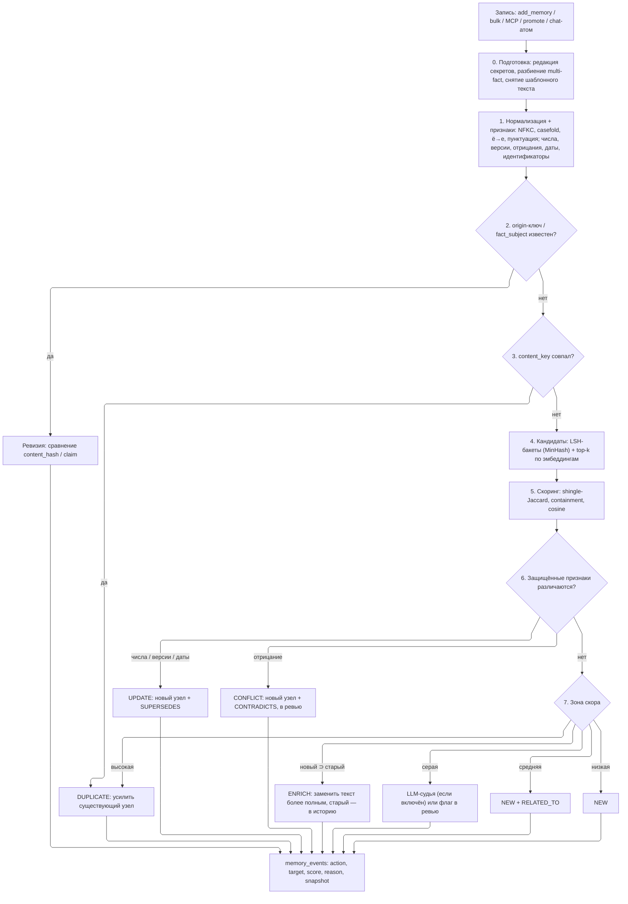
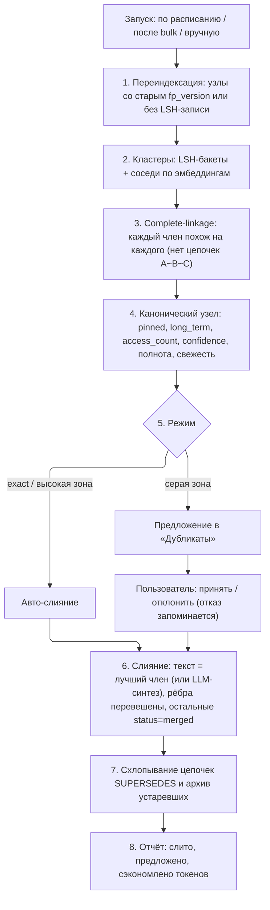

# Дедупликация и оптимизация памяти — дизайн

Статус: **этапы 0 и 1 выполнены** (дефекты 1–4 и 9 из §1.1, см. §3.6 и §8);
этапы 2–4 — предложение. Цель: любая запись в память автоматически проходит один и тот же
шлюз, который отсекает дубликаты, распознаёт обновления и конфликты, а уже
сохранённые данные периодически уплотняются — без молчаливой потери фактов.

---

## 1. Как сейчас

Сейчас в коде четыре независимых механизма, у каждого свои токены и пороги:

| Путь записи | Где | Что делает | Порог |
| --- | --- | --- | --- |
| Очередь кандидатов (AutoScan, Ask, MCP-атомы) | `memory_ingestion.py` → `prepare_candidates`, `_find_duplicate` | origin-ключ, отпечаток, Jaccard/containment по токенам | 0.68 (0.82 для коротких Granola) |
| Прямая запись (`add_memory`, MCP `memory_add`, bulk) | `ingestion_service.py:481` `_ingest_dedup_scan` | точное совпадение `label+text` (только пробелы и регистр); близкий дубль лишь помечается `possible_duplicate_of` | 0.72 (только флаг) |
| Авто-принятие чат-атомов | `chat_session_service.py:861` | блокирует авто-запись близкого дубля | 0.72 |
| Консолидация | `graph_suggest_service.py:164` `suggest_consolidations` | вручную, LLM решает `merge / contradicts / keep`, пул — 40 последних узлов | 0.45 + LLM |

Что уже хорошо и должно остаться: origin-ключи (`candidate_identity.py`) не дают
повторно завести принятый/отклонённый объект; ревизии (`revision_of` +
`SUPERSEDES` + `invalid_at`) вместо дублей для изменившегося кода и фактов с
тем же `fact_subject`; `dedup_hits` при повторе точной копии; транзакции на merge.

### 1.1. Найденные дефекты (воспроизведены)

Проверено скриптом на чистой БД (`ArchitectOSService(tmp)`).

1. **Кириллица невидима для дедупа → потеря данных.**
   `TOKEN_RE = [a-z0-9]…` (`memory_ingestion.py:55`) — только ASCII.
   `"Проект использует PostgreSQL 16 для хранения данных"` → токены `{'postgresql'}`.
   Чисто русский факт получает пустой отпечаток `''`. В `prepare_candidates`
   (`:189`) пустой отпечаток попадает в `seen_fingerprints`, и **второй любой
   русский факт-атом в том же пакете молча отбрасывается** (для атомов стоит
   `skipped_reviewed += 1; continue`).
   Воспроизведение: пакет из 4 разных русских MCP-атомов → сохранено 3,
   «Бэкенд работает только на stdlib» потерян.
   Обратная сторона: факты, где общий только `sqlite`, получают сходство **1.0**
   (`{'sqlite'}` vs `{'sqlite'}`), хотя могут утверждать противоположное.
2. **Отпечаток = первые 18 токенов по алфавиту** (`fingerprint_from_tokens`,
   `:101`). Два длинных текста с одинаковыми 18 «алфавитно первыми» токенами
   считаются точной копией (score 1.0), даже если различаются по сути
   («… uses postgres» vs «… uses mysql» → одинаковый отпечаток).
3. **Точное совпадение слишком буквальное.** `_normalize_fact_text` схлопывает
   только пробелы и регистр: «…SQLite» и «…SQLite.» — разные факты, создаются
   два узла.
4. **Флаг `possible_duplicate_of` никто не потребляет**, кроме авто-принятия чата.
   Узел создаётся, метка висит, слияния нет.
5. **Только лексика.** Эмбеддинги в проекте есть (`embeddings.py`), но в дедупе
   не участвуют — перефразы («данные лежат в SQLite» / «БД проекта — SQLite»)
   проходят как новые факты.
6. **O(N) на каждую запись.** `_ingest_dedup_scan` и `_reference_items` обходят
   `list_nodes()` целиком; `add_memory_bulk` на 200 элементов — 200 полных
   проходов. `refresh_candidate_duplicate_flags` — O(P²) по очереди.
7. **Слияние раздувает, а не оптимизирует.** `merge_graph_nodes`
   (`graph_service.py:694`) склеивает тексты `"…\n\nMerged from X:\n…"` до 6000
   символов. После нескольких слияний узел — это несколько копий одного факта.
8. **Нет фоновой консолидации** уже сохранённых данных: только ручной вызов
   `/api/graph/suggest-consolidations` с LLM.
9. **Одинаковый заголовок перезаписывает факт.** `add_node` строит id как
   `stable_id(type, scope, project, interface, label)` и пишет через
   `INSERT OR REPLACE`. «Лимит API: 5000» и затем «Лимит API: 9000» с тем же
   label — это один id: первый факт молча заменяется, без `SUPERSEDES`, с потерей
   `created_at` и счётчиков lifecycle. Особенно опасно для агентов, которые
   ставят общий label («Decision», «Note»). Чинится действием UPDATE (этап 1).

---

## 2. Принципы

1. **Один шлюз** для всех путей записи — одинаковая нормализация, признаки и
   пороги для `add_memory`, bulk, MCP, промоута кандидатов и чат-атомов.
2. **Ничего не теряем молча.** Каждое «отсечение» — это действие с записью в
   `memory_events` (что, с чем, почему, скор) и возможностью отмены. Жёсткого
   удаления шлюз не делает никогда.
3. **Числа, версии, отрицания и даты — защищённые различия.** «лимит 5000» и
   «лимит 9000», «используем X» и «не используем X» не могут быть дубликатом —
   это обновление или конфликт.
4. **Детерминированный быстрый путь без зависимостей** (stdlib, как весь
   бэкенд). Эмбеддинги и LLM — необязательные уточнители для серой зоны.
5. **Границы scope не пересекаются автоматически.** `project` ↔ `shared` ↔
   `global` и разные проекты — только предложение, не авто-слияние.
6. **Закреплённое (`pinned` / `favorite`) не сливается автоматически.**

---

## 3. Архитектура

Новый модуль `backend/architectos/memory_dedup.py` с классом `MemoryDedupGate`.
Существующие `MemoryIngestionEngine` (очередь) и `_ingest_dedup_scan` (прямая
запись) переходят на него; origin-ключи и ревизии остаются как первый этап.



### 3.1. Нормализация (этап 1)

- `unicodedata.normalize("NFKC")`, `casefold()`, `ё → е`, схлопывание пробелов,
  удаление пунктуации на краях и повторов (`…`, `!!!`).
- **Токены — Unicode** (`\w` с флагом `re.UNICODE`), минимальная длина 2, стоп-слова
  RU + EN.
- **Лёгкий стемминг без зависимостей**: для кириллицы — отсечение типичных
  окончаний (`-ами`, `-ого`, `-ует`, `-ться`, …) с минимальной длиной основы 4;
  для латиницы — `-ing`, `-ed`, `-s`. Цель — «хранит/хранятся/хранения» в одну
  основу, а не лингвистическая точность.
- **Шинглы** — символьные 4-граммы по нормализованному тексту. Работают для
  коротких фактов и для смеси языков лучше, чем токены.
- **content_key** = `sha256(нормализованный label + "\n" + нормализованный text)`.
  Это замена «точного совпадения» и заодно исправление дефекта 3.
- **Отпечаток** = `sha1` от **всего** отсортированного набора основ, а не первых
  18 токенов (исправление дефекта 2). `FINGERPRINT_VERSION = 3` — существующая
  миграция пересчёта отпечатков уже умеет пересчитывать старые версии.

### 3.2. Защищённые признаки

Извлекаются регулярками на этапе 1 и хранятся рядом с узлом:

| Признак | Примеры | Если различается при высоком сходстве |
| --- | --- | --- |
| числа с единицами | `5000`, `30 дней`, `2.5 GB` | UPDATE (новее → SUPERSEDES старого) |
| версии | `v2`, `3.12`, `PostgreSQL 16` | UPDATE |
| даты | `2026-10-01`, `до пятницы` | UPDATE |
| отрицание | `не`, `нет`, `никогда`, `not`, `never`, `no longer`, `больше не` | CONFLICT |
| идентификаторы | пути, `CamelCase`, `snake_case`, URL, `#123` | разные → не дубль (это разные объекты) |

Пример: «Таймаут сессии — 30 минут» и «Таймаут сессии — 45 минут» → сходство
высокое, числа различаются → **UPDATE**, старый узел получает `invalid_at`,
новый — ребро `SUPERSEDES` (механизм уже есть: `_apply_revision_supersede`).

### 3.3. Поиск кандидатов вместо полного прохода (дефект 6)

- **MinHash** (64 перестановки над шинглами, stdlib `hashlib`/`zlib.crc32`) +
  **LSH** 16 бакетов × 4 строки. Сравниваем только с узлами, попавшими хотя бы в
  один общий бакет — O(1) в среднем вместо O(N).
- **Семантика**: если настроен реальный провайдер эмбеддингов (не `hash` —
  `HashEmbeddingProvider` не семантический), вектор входящего текста считается
  один раз, по нему берётся top-k (k=8) через существующий `search_scored`, и
  тот же вектор потом уходит в индекс — без повторного вызова провайдера.
- Индексация эмбеддингов асинхронная, поэтому свежие, ещё не проиндексированные
  узлы ловятся LSH-индексом (он пишется синхронно в той же транзакции).

### 3.4. Скоринг и решение (этапы 5–7)

```
lex  = max(jaccard(shingles), 0.85 * containment(stems))
sem  = cosine(embedding)              # 0, если семантика недоступна
score = sem > 0 ? 0.4*lex + 0.6*sem : lex
```

Пороги по умолчанию (стартовые — **требуют калибровки на реальных данных**, см. §7):

| Зона | Условие | Действие |
| --- | --- | --- |
| exact | `content_key` совпал | DUPLICATE |
| высокая | `score ≥ 0.90`, признаки равны | DUPLICATE |
| поглощение | `containment(старый ⊂ новый) ≥ 0.9`, новый длиннее ≥ 20% | ENRICH |
| серая | `0.75 ≤ score < 0.90` | LLM-судья → DUPLICATE / ENRICH / NEW; без LLM — NEW с флагом `possible_duplicate_of` + карточка в «Дубликаты» |
| средняя | `0.55 ≤ score < 0.75` | NEW + `RELATED_TO` (через `graph_auto_linker`) |
| низкая | `< 0.55` | NEW |

Отдельные пороги для источников с коротким текстом (Granola-заглушки, заголовки
work items) остаются, но переезжают в настройки, а не в код.

### 3.6. Что реализовано в этапе 1

Без эмбеддингов и LLM правила сознательно строже таблицы выше: ложное слияние
хуже пропущенного дубля. Модуль `backend/architectos/memory_dedup.py`,
`MemoryDedupGate.classify` / `compare`. Сравниваются только активные, не
устаревшие (`invalid_at`) узлы того же scope/проекта и того же типа, либо любые два
типа фактов (`Lesson`/`Decision`/`Requirement`/`Constraint`).

| Действие | Условие | Результат |
| --- | --- | --- |
| `duplicate` | label и text совпали после нормализации (NFKC, регистр, ё/е, пунктуация на краях) | узел не создаётся; у существующего `dedup_hits`, `dedup_sources`, `max(confidence)`, более сильный тип |
| `duplicate` | одинаковые наборы основ слов (≥ 3), те же числа, отрицание, идентификаторы и тот же предмет (label) | то же |
| `update` | тот же предмет, Jaccard основ ≥ 0.8, числа различаются | новый узел + `SUPERSEDES`, старый получает `invalid_at` |
| `conflict` | тот же предмет, Jaccard основ ≥ 0.8, отрицание различается | новый узел + `CONTRADICTS`, `needs_review: conflict` |
| `new` | всё остальное; близость ≥ 0.72 → `possible_duplicate_of` | новый узел |

«Тот же предмет» = совпадают слова label без чисел и отрицаний. Короткие слова в
верхнем регистре (`A`, `B`, `БД`, `UI`) считаются основами, поэтому «Сервис A» и
«Сервис B» не склеиваются. Разные идентификаторы (пути, `snake_case`, URL, `#123`)
— всегда разные факты. Входящий текст перед сравнением проходит ту же редакцию
секретов, что и хранимый.

Пути записи: `add_memory`, `add_memory_from_agent` (MCP `memory_add`),
`add_memory_bulk` (один снимок узлов на весь пакет), авто-принятие чат-атомов
(всё, кроме `new`, остаётся в ревью). `promote_memory_candidate` проверяет только
узел с тем же label-id (кандидаты уже прошли дедуп при постановке в очередь):
та же формулировка → слияние, иная → новый узел рядом.

Дефект 9 закрыт: если активный узел уже занимает label-id, новый факт получает
id с солью от текста (`content_salt`), старый не перезаписывается. Существующие id
не меняются.

Каждое решение `duplicate`/`update`/`conflict` пишется событием `dedup` в
`memory_node_events` (для `duplicate` — со снимком входящего факта после
редакции секретов) и отменяется через `POST /api/memory/dedup/undo`.

### 3.5. Что значит «усилить» (DUPLICATE)

Новый узел не создаётся. Существующему:

- `dedup.hits += 1`, `dedup.last_seen_at`, `dedup.sources` — список (до 20)
  `{source_type, source_ref, at}`, чтобы было видно, что факт подтверждён из
  нескольких мест;
- `confidence = max(old, new)`, плюс небольшой бонус за независимое
  подтверждение из другого источника (`+0.03`, потолок 0.97);
- `memory_lifecycle.refresh_nodes([id], "dedup")` — продлевает жизнь и может
  перевести в long-term (уже работает через `promote_after_hits`);
- в ответ вызывающему: `{"dedup": {"action": "duplicate", "target_id", "score",
  "reason"}}` — агент через MCP видит, что запись не создана, и почему.

---

## 4. Оптимизация новых данных (до записи)

1. **Разбиение multi-fact** (`facts_from_memory_blob`) — сейчас только в
   `add_memory_from_agent`; применять во всех путях, где текст длиннее порога.
   Каждый факт проходит шлюз отдельно.
2. **Снятие шаблонного текста** (`CHAT_FACT_BOILERPLATE_PREFIXES`) — не только
   для отпечатка, но и для хранимого текста атомов.
3. **Канонический label**: если label пустой или равен первым 72 символам текста —
   генерировать из основ (`subject: claim`), чтобы списки читались.
4. **Сжатие длинных фактов** (опционально, LLM): текст длиннее
   `compress_over_chars` (по умолчанию 1500) пересказывается в 1–3 предложения;
   оригинал сохраняется как evidence-файл (механизм evidence уже есть), в узле
   хранится краткая версия.

---

## 5. Оптимизация уже сохранённых данных (компактизация)

Фоновая задача `memory_compaction`, запускается из того же цикла, что и
lifecycle decay, инкрементально (курсор по `updated_at`) и с бюджетом.



Ключевые решения:

- **Complete-linkage**, а не union-find: текущий `refresh_candidate_duplicate_flags`
  объединяет транзитивно, и цепочка A≈B, B≈C склеивает A и C, которые могут
  быть разными фактами.
- **Слияние без конкатенации** (дефект 7). Новый параметр
  `merge_graph_nodes(..., strategy=...)`:
  - `keep_best` (по умолчанию) — текст канонического узла не меняется, слитые
    тексты уходят в `memory_events` как снапшоты;
  - `synthesize` — LLM объединяет дополняющие друг друга формулировки в одну
    (только если члены различаются по содержанию, а не по формулировке);
  - `append` — текущее поведение, для обратной совместимости.
- **Отклонённые пары запоминаются** (`dedup_rejected_pairs`), чтобы компактизация
  не предлагала их снова — так же, как origin-ключи для кандидатов.
- **Бюджет**: `max_clusters_per_run` (50), `max_llm_calls_per_run` (20),
  ограничение по времени — задача не должна держать write-lock дольше одной
  транзакции на кластер (как уже сделано в `merge_graph_nodes`).
- Существующий `suggest_consolidations` становится тонкой обёрткой над этой
  задачей в режиме dry-run.

---

## 6. Данные, настройки, API

### 6.1. Хранилище

```sql
CREATE TABLE memory_dedup_index (
    node_id     TEXT PRIMARY KEY,
    kind        TEXT NOT NULL,          -- node | candidate
    scope       TEXT NOT NULL,
    project_id  TEXT,
    content_key TEXT NOT NULL,
    fingerprint TEXT NOT NULL,
    fp_version  INTEGER NOT NULL,
    minhash     BLOB NOT NULL,          -- 64 × uint32
    features    TEXT NOT NULL,          -- JSON: numbers, versions, dates, negation, identifiers
    updated_at  TEXT NOT NULL
);
CREATE INDEX idx_dedup_content ON memory_dedup_index(scope, project_id, content_key);

CREATE TABLE memory_dedup_bands (
    band_key TEXT NOT NULL,             -- "{scope}|{project}|{band_no}|{hash}"
    node_id  TEXT NOT NULL,
    PRIMARY KEY (band_key, node_id)
);

CREATE TABLE dedup_rejected_pairs (
    left_id  TEXT NOT NULL,
    right_id TEXT NOT NULL,             -- left_id < right_id
    at       TEXT NOT NULL,
    PRIMARY KEY (left_id, right_id)
);
```

Индекс обновляется в той же транзакции, что и `upsert_node` / `add_node`;
при удалении/архивации узла — строки удаляются. Миграция — через
`storage_migrate.py`, первичное заполнение — фоновой переиндексацией (§5, шаг 1).

### 6.2. Настройки `memory_dedup`

```jsonc
{
  "enabled": true,
  "mode": "auto",               // auto | suggest | off
  "semantic": "auto",           // auto = только при реальном провайдере эмбеддингов
  "llm_judge": false,
  "thresholds": { "duplicate": 0.90, "gray": 0.75, "related": 0.55, "enrich_containment": 0.90 },
  "compaction": { "enabled": true, "interval_hours": 24, "max_clusters_per_run": 50,
                  "max_llm_calls_per_run": 20, "merge_strategy": "keep_best" },
  "compress_over_chars": 0      // 0 = выключено
}
```

`mode: "suggest"` — шлюз ничего не сливает сам, только помечает и создаёт
предложения; удобно на время калибровки.

### 6.3. API / MCP / UI

- ✅ Ответ `add_memory`, bulk и MCP `memory_add` получает поле
  `dedup: {action, target_id, target_label, score, reason, near_id, near_score, event_id}`.
  В bulk `stats` добавлены `superseded` и `conflicts`, в `results` — `dedup_action`.
- ✅ `POST /api/memory/dedup/preview` — что шлюз сделал бы с текстом (без записи).
- ✅ `POST /api/memory/dedup/undo` — `{event_id}`: `duplicate` → поглощённый факт
  восстанавливается отдельным узлом, тип и `dedup_hits` откатываются;
  `update`/`conflict` → ребро удаляется, старый факт снова действителен.
  (`dedup_rejected_pairs` — этап 4.)
- `POST /api/memory/compact` — `{dry_run: true}` по умолчанию; отчёт.
- MCP: инструмент `memory_compact` (dry-run) для агентов.
- UI Memory: фильтр «Дубликаты» (серая зона и предложения компактизации) с
  кнопками «Слить» / «Разные» / «Отменить слияние».

---

## 7. Качество и проверка

- **Эталонный набор пар** `tests/data/dedup_pairs.jsonl` (RU + EN + смешанные):
  `{a, b, expected: duplicate|update|conflict|enrich|related|new}`. Обязательные
  группы: перефразы, числа/версии, отрицания, разные идентификаторы, короткие
  заголовки, длинные тексты с общим началом (дефект 2), чисто кириллические
  факты в одном пакете (дефект 1).
- **Метрики**: precision авто-слияния ≥ 0.98 (ложное слияние хуже пропущенного
  дубля), recall дублей — отслеживать; отчёт в `scripts/bench_memory.py`.
- **Нагрузка**: запись в базу на 50 000 узлов — не дольше 20 мс на факт без
  семантики (LSH), bulk 200 фактов — без полного прохода по узлам.
- Регресс-тесты на каждый дефект из §1.1.

---

## 8. Поэтапный план

| Этап | Объём | Результат |
| --- | --- | --- |
| **0. Исправления** ✅ | Unicode-токенизатор + RU-стоп-слова, `FINGERPRINT_VERSION = 3` и миграция 006, дайджест всего набора в отпечатке, пустой отпечаток не участвует в `seen_fingerprints`, нормализация exact (NFKC, регистр, ё, пунктуация на краях), точный дубль между типами фактов → сильнейший тип; `tests/test_memory_dedup.py` | Нет потери русских фактов, нет ложных «точных» совпадений |
| **1. Единый шлюз** ✅ | `memory_dedup.py`: нормализация, защищённые признаки, exact + лексика; подключить `add_memory`, bulk, MCP, promote, чат-атомы; поле `dedup` в ответах; `memory_events` + undo; UPDATE вместо перезаписи по label (дефект 9) | Одинаковое поведение на всех путях, UPDATE/CONFLICT вместо ложных дублей |
| **2. Индекс** | таблицы §6.1, MinHash/LSH, миграция и переиндексация | O(1) вместо O(N) на запись |
| **3. Семантика и LLM** | top-k по эмбеддингам, LLM-судья для серой зоны, ENRICH | Ловятся перефразы |
| **4. Компактизация** | фоновая задача, `merge_strategy`, UI «Дубликаты», `dedup_rejected_pairs` | Уже сохранённое уплотняется и не раздувается |

Каждый этап самостоятелен и включается настройкой; до калибровки порогов на
реальной базе этапы 3–4 стоит запускать в `mode: "suggest"`.

## 9. Открытые вопросы

- ~~Слияние между типами~~ — **решено**: одинаковый текст у фактов разных типов —
  дубль, остаётся более сильный тип по уже существующему в `chat_memory.py`
  рангу `Constraint > Requirement > Decision > Lesson` (реализовано в этапе 0 для
  точных совпадений; для близких — в этапе 1).
- **Авто-слияние уже сохранённого** — по умолчанию только exact и высокая зона;
  если нужно строже (всё через ревью), достаточно `compaction.mode = suggest`.
- **Пороги** в §3.4 — стартовые значения, а не измеренные; их надо выставить по
  эталонному набору и выгрузке реальной базы.
